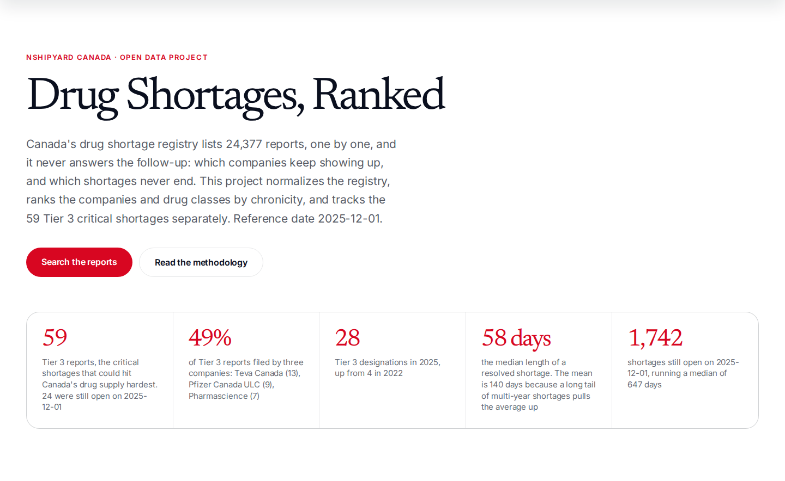
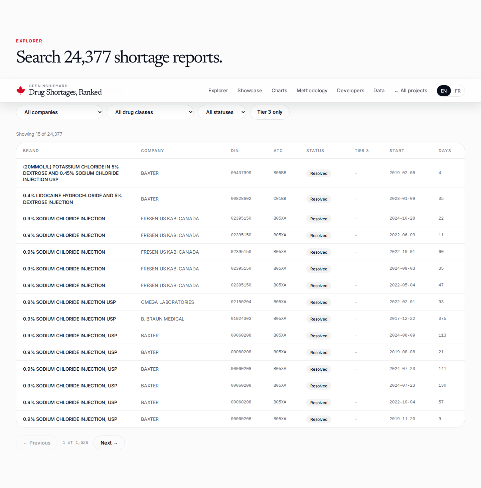
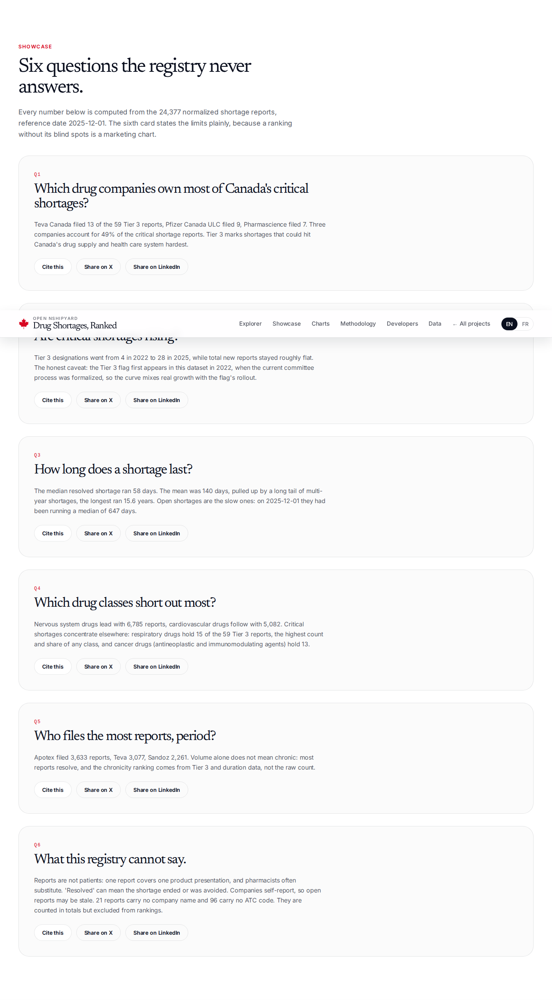
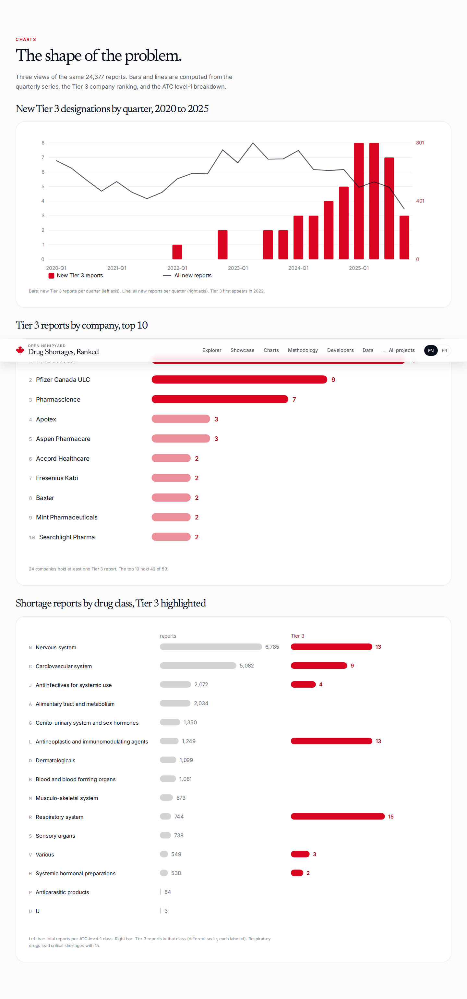
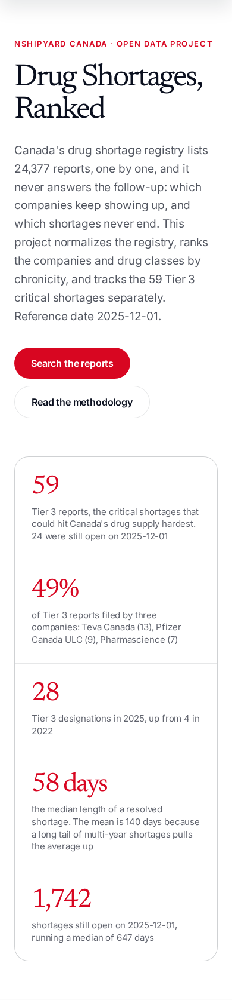
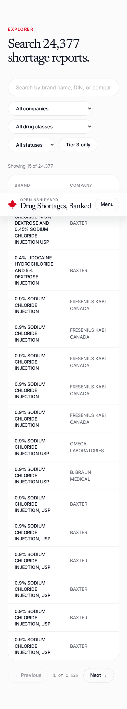

# Drug Shortages, Ranked

Canada's drug shortage registry lists 24,377 reports, one by one, and it never answers the follow-up: which companies keep showing up, and which shortages never end. This project normalizes the registry, ranks the companies and drug classes by chronicity, and tracks the 59 Tier 3 critical shortages separately.

**Planned domain:** shortages.canada.nshipyard.com
**Reference date:** 2025-12-01. **Extract archived:** 2025-12-20.

## What it is

An open-source web app (Next.js 16, EN/FR) over the Health Product Shortages Canada monthly bulk extract. Sections: hero with 5 stat cards, a searchable explorer of all 24,377 shortage reports, a 6-card showcase of questions the registry never answers, 3 hand-built SVG charts, full methodology, REST + OpenAPI + MCP developer docs, and CSV/JSON downloads.

## Three headline findings

1. **Three companies hold 49% of the critical shortages.** Teva Canada filed 13 of the 59 Tier 3 reports, Pfizer Canada ULC 9, Pharmascience 7. The top 5 hold 59.3%.
2. **Tier 3 designations rose from 4 in 2022 to 28 in 2025**, while total new reports stayed roughly flat. Honest caveat: the Tier 3 flag first appears in this dataset in 2022, when the current committee process was formalized, so the curve mixes real growth with the flag's rollout.
3. **The median resolved shortage lasted 58 days. The mean was 140**, pulled up by a long tail of multi-year shortages (longest: 15.6 years). Shortages still open on 2025-12-01 had already run a median of 647 days.

## Data sources and vintage

- **Source:** Health Product Shortages Canada monthly bulk extract (originally drugshortagescanada.ca, now healthproductshortages.ca), archived 2025-12-20, reference date 2025-12-01.
- **Baseline replaced:** the PMPRB 2022 analytical study on drug shortages, a one-off. This tracker is designed as its living replacement.
- **Files:** `src/lib/*.json` (computed aggregates: insights, companies, atc, trends, and the 24,377-record `reports.json`), `public/data/shortages_clean.csv`, `public/data/discontinuations_clean.csv`, `public/data/company_merges.json`, `public/data/quarantine.json`.
- **Build script:** `scripts/build_data.py`.

## API

- `GET /api/v1/summary` - headline aggregates (counts, Tier 3 totals and shares, duration stats)
- `GET /api/v1/shortages/search?q=&company=&atc1=&tier3=&status=&page=&limit=` - 24,377 reports, server-side search (limit 25 default, 100 max)
- `GET /api/v1/companies?sort=tier3|reports|days` - 239 canonical companies, ranked
- `GET /api/v1/companies/tier3` - the critical-shortage ranking with concentration shares
- `GET /api/v1/trends` - quarterly series 2020-Q1 to 2025-Q4
- `GET /api/v1/atc` - ATC level-1 breakdown and top-30 level-2 classes
- `GET /api/openapi.json` - OpenAPI 3.1 spec
- `POST /mcp` - streamable-HTTP MCP: `shortage_lookup`, `company_ranking`, `tier3_trend`, `atc_breakdown`

## Screenshots

## Honest limits

- Reports are product presentations, not patients. Pharmacists often substitute.
- Companies self-report, so open reports may be stale. "Resolved" can mean the shortage ended or was avoided.
- 21 reports carry no company name and 96 carry no ATC code. They are counted in totals but excluded from rankings.
- Discontinuations (3,221 reports) are tracked separately and excluded from every shortage ranking.
- The Tier 3 flag first appears in the data in 2022. Earlier years cannot be compared on Tier 3.

## Author

Built by [Richardson Dackam](https://x.com/richardsondx) · [github.com/richardsondx](https://github.com/richardsondx)

An independent open-source project. Not affiliated with the Government of Canada or Health Canada.
